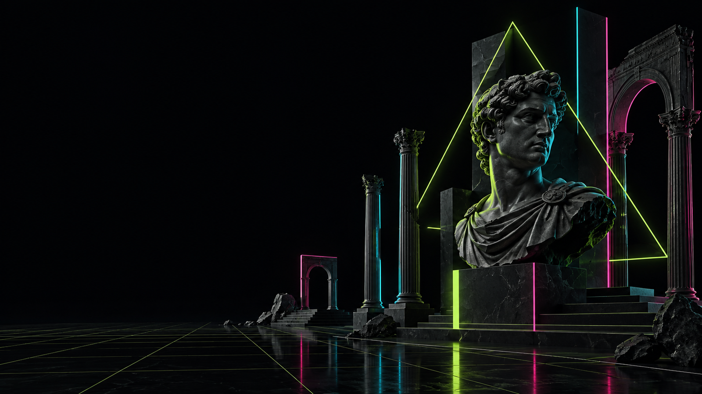

# Acid Empire theme for Omarchy

A dark vaporwave theme for [Omarchy](https://omarchy.org): black marble and
Roman ruins edged in acid-lime, electric-cyan and hot-pink neon. Ink-black
surfaces, a lime-to-cyan-to-pink gradient on the focused window, and a palette
tuned to keep the screen quiet.



## Install

```bash
omarchy theme install https://github.com/neilofneils404/omarchy-acid-empire-theme
```

## Background

`backgrounds/` holds a single 3840x2160 wallpaper. It is a Lanczos upscale of
the original 1672x941 render, which is kept in `source/`. The prompt behind
it is in `prompts/`.

## Palette

| Role | Colour |
| --- | --- |
| Background | `#06090F` |
| Foreground | `#D6F3E5` |
| Accent | `#B6FF00` |
| Neon | `#B6FF00` `#00E5FF` `#FF38A2` |

App configs (terminal, editor, browser, btop and more) are generated from
`colors.toml` by Omarchy's templates. `shell.toml` styles the bar, menus and
lock screen.

## Licence

MIT
